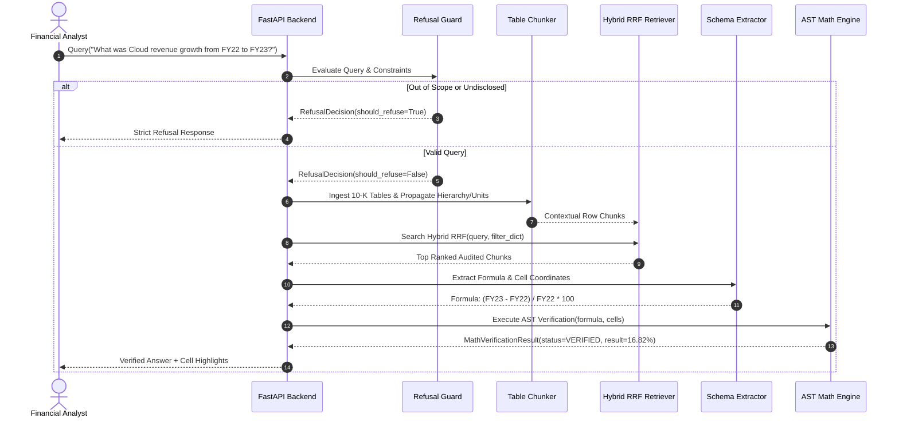

# Ledger AI: Technical Architecture & System Specification

> **System Overview:** Ledger AI is an audit-grade financial question answering engine engineered for SEC Forms 10-K and 10-Q filings. It eliminates arithmetic hallucinations by combining table-aware contextual chunking, hybrid search (BM25 + Dense RRF), a sandboxed AST math engine with `decimal.Decimal`, and a calibrated refusal guard.

---

## 1. Directory Structure

```text
Ledger-AI/
├── ARCHITECTURE.md                  # System architecture & design specification
├── requirements.txt                 # Hardened, pinned dependencies
├── run.py                           # Application entrypoint & terminal launcher
├── Makefile                         # Test and evaluation targets
├── README.md                        # Documentation, benchmarks, and API usage
├── LICENSE                          # MIT License
├── data/
│   └── financebench_sample.jsonl    # Curated SEC 10-K benchmark cases (FinanceBench)
├── src/
│   ├── __init__.py
│   ├── table_parser.py              # Table-aware hierarchy & footnote chunking engine
│   ├── hybrid_retriever.py          # BM25 + Dense search with weighted RRF & reranking
│   ├── math_verifier.py             # AST-whitelisted decimal.Decimal execution engine
│   ├── refusal_guard.py             # Calibrated refusal guard (temporal & non-disclosed boundaries)
│   └── eval_runner.py               # 4-way ablation benchmark evaluation runner
├── web/
│   ├── server.py                    # FastAPI service exposing query & benchmark endpoints
│   └── static/                      # Dark-mode Financial Terminal UI
│       ├── index.html
│       ├── style.css
│       └── app.js
└── tests/
    ├── test_data_integrity.py       # Benchmark fixture validation
    ├── test_core_engine.py          # Unit tests for parser, retriever, and verifier
    ├── test_core_engine_expanded.py # Tests for CAGR, variable resolution, and prefiltering
    └── test_server_api.py           # End-to-end FastAPI integration tests
```

---

## 2. Core Processing Pipeline



---

## 3. Component Design

### 3.1 Table-Aware Parser (`src/table_parser.py`)
* **Context Preservation:** Binds document metadata, parent category (`hierarchy_path`), fiscal periods, and unit scales (`$ in millions`) to every row chunk.
* **Footnote Extraction:** Detects footnote citations (`(1)`, `[a]`, `*`) and binds them into row metadata.
* **HTML Ingestion:** Parses raw SEC EDGAR HTML tables into structured tables.

### 3.2 Hybrid Retriever (`src/hybrid_retriever.py`)
* **Dual Indexing:** In-memory BM25 (`rank-bm25`) for exact financial line items and dense vector cosine similarity for conceptual semantics.
* **Reciprocal Rank Fusion (RRF):** Fuses rankings using configurable weights ($\alpha \cdot RRF_{sparse} + (1-\alpha) \cdot RRF_{dense}$).
* **Second-Stage Reranker:** Boosts candidate chunks containing exact numbers, dates, and metric tokens.

### 3.3 Deterministic Math Engine (`src/math_verifier.py`)
* **AST Whitelist:** Restricts syntax strictly to binary operations (`+`, `-`, `*`, `/`, `**`) and numeric constants.
* **Zero RCE Guarantee:** Any function call, attribute access, or variable assignment raises an immediate exception.
* **High Precision:** Evaluates using Python's `decimal.Decimal` (28-digit precision).
* **Advanced Financial Math:** Supports CAGR, compound interest, symbolic variable bindings, and scale conversions (thousands to millions).

### 3.4 Calibrated Refusal Guard (`src/refusal_guard.py`)
* **Safety Thresholds:** Refuses queries when retrieval confidence falls below threshold.
* **Boundary Checks:** Rejects forward-looking projections and temporal queries outside the filing's reported years.
