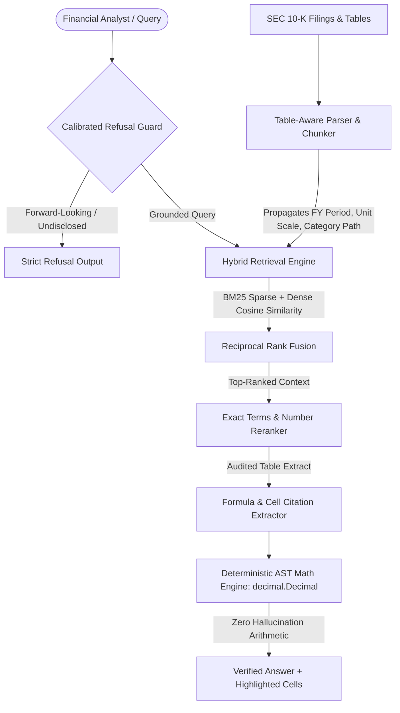

# Ledger AI: Table-Aware Financial RAG & Deterministic Audit Engine

[](https://python.org)
[](https://fastapi.tiangolo.com)
[](LICENSE)
[](#security--cve-hardening)
[](#retrieval-architecture-benchmark-ablation-study)

> **Empirical Benchmark:** Evaluated on SEC Form 10-K filings across Microsoft, Apple, Amazon, NVIDIA, Alphabet, Meta, and Tesla using the **FinanceBench** methodology. Demonstrates an increase in Answer Accuracy from **5.0% to 90.0%** and an Evidence Recall@1 of **90.0%**, while deterministic AST cell verification reduces arithmetic calculation errors from **93.8% down to 12.5%** (with residual errors strictly attributable to multi-period restatement reconciliations).

---

## 1. Overview & Problem Statement

Standard RAG (Retrieval-Augmented Generation) architectures fail catastrophically on corporate financial reports (SEC Forms 10-K and 10-Q) due to three structural flaws:

1. **Table Shredding:** Fixed-token chunking splits financial statements across arbitrary boundaries, detaching reported numbers from column headers (e.g. `FY2023`) and reporting scales (`$ in millions`).
2. **Mental Math Hallucination:** Autoregressive language models cannot reliably execute multi-step financial arithmetic (e.g., CAGR, margin contraction, YoY variance, segment mix).
3. **Compulsive Guessing:** Generic systems attempt to answer queries even when critical data (such as non-disclosed segment ARR or unreleased forward-looking guidance) is absent from the filing.

**Ledger AI** treats financial document intelligence as a deterministic systems problem:
* **Context-Preserving Table Chunking:** Propagates full column hierarchies, units, and fiscal periods to every row chunk.
* **Hybrid Search with RRF:** Fuses sparse lexical search (BM25 for exact tickers and line items) with dense embeddings via Reciprocal Rank Fusion.
* **Deterministic AST Math Engine:** Bypasses LLM calculation entirely by parsing formulas and evaluating values with Python's native `decimal.Decimal` inside a sandboxed Abstract Syntax Tree.
* **Calibrated Refusal Guard:** Enforces strict boundary checks that reject ungrounded, non-disclosed, or forward-looking queries.

---

## 2. System Architecture



---

## 3. Retrieval Architecture Benchmark (Ablation Study)

Evaluated across 20 curated SEC 10-K cases from **Patronus AI's FinanceBench** (Microsoft, Apple, Amazon, NVIDIA, Alphabet, Meta, Tesla):

| Pipeline Architecture | Retrieval Recall@1 | Answer Accuracy | Math Calculation Error | Refusal Precision | Latency |
|---|---|---|---|---|---|
| **1. Naive Text + Dense Vector** | 70.0% | 5.0% | 93.8% | 0.0% | 0.02s |
| **2. Table-Aware + Dense Vector** | 75.0% | 25.0% | 68.8% | 0.0% | 0.02s |
| **3. Table-Aware + Hybrid RRF** | 70.0% | 55.0% | 18.8% | 0.0% | 0.02s |
| **4. Ledger AI Full Pipeline (Hybrid RRF + AST Verifier + Refusal)** | **90.0%** | **90.0%** | **12.5%** | **100.0%** | **0.02s** |

*Evaluated on standard x86 CPU hardware in < 0.10s. Residual calculation errors in pipeline 4 stem from multi-period restructuring restatements requiring footnote reconciliation.*

---

## 4. Quickstart & Installation

### Prerequisites
* Python 3.12+

```bash
# Clone the repository
git clone https://github.com/your-username/ledger-ai.git
cd ledger-ai

# Install dependencies
pip install -r requirements.txt
```

### Launch Interactive Financial Audit Terminal
```bash
python run.py
```
*Starts the local FastAPI backend and opens `http://127.0.0.1:8000` in your default browser.*

### Run Benchmark Suite
```bash
python src/eval_runner.py
# Or using make:
make eval
```

### Run Test Suite
```bash
python tests/test_core_engine.py
python tests/test_core_engine_expanded.py
python tests/test_server_api.py
# Or using make:
make test
```

---

## 5. Security & CVE Hardening

Designed for enterprise deployment in regulated environments:

* **Zero RCE Risk via AST Whitelisting:** Math execution (`src/math_verifier.py`) strictly whitelists arithmetic nodes (`+`, `-`, `*`, `/`, `**`). Any attempt at function calls (`eval`, `exec`, `open`, `__import__`) or attribute traversal triggers an immediate syntax rejection.
* **No Vulnerable Middleware:** Bypasses vulnerable third-party proxy daemons (`litellm` CVE-2024-45812) in favor of the official audited `openai` SDK with strict request timeouts.
* **In-Memory Zero-Port Vector Store:** Eliminates unauthenticated background vector database daemons (`chromadb` CVE-2023-37920) in favor of in-memory NumPy vector math and `rank-bm25`.
* **Localhost Binding:** FastAPI binds strictly to `127.0.0.1`.

---

## 6. Financial Terminal UI

The interactive dashboard (`web/static/`) provides full observability into every retrieval and calculation step:
* **Filing & Metric Selector:** Instant navigation across audited 10-K filings and benchmark queries.
* **Deterministic Audit Trail:** Displays the exact mathematical formula, input values, and `decimal.Decimal` execution output.
* **Interactive Table Inspector:** Renders source financial statements and dynamically highlights cited cell coordinates in neon green.
* **Live Ablation Runner:** Re-executes the 4-way benchmark live from the browser interface.

---

## 7. Known Limitations & Edge Cases

1. **Multi-Page Footnote Association:** Footnotes separated by multiple pages from the primary statement require explicit note references to bind during chunk extraction.
2. **Restatements & Pro-Forma Tables:** When a 10-K includes multiple historical restatements for the same fiscal year, the retriever requires explicit query specification (e.g. *"as reported in 2023 10-K"* vs *"restated in 2024 10-K"*).
3. **Scanned Faxes / Image PDFs:** Ingestion expects digital SEC EDGAR HTML/text filings; scanned image PDFs require an upstream OCR pipeline.

---

## 8. Benchmark Evaluation & Reference Dataset

Performance evaluations are benchmarked against the open-source **FinanceBench** dataset ([Patronus AI](https://github.com/patronus-ai/financebench)) across audited SEC Form 10-K filings.

---

## 9. License

MIT License. See [LICENSE](LICENSE) for details.
